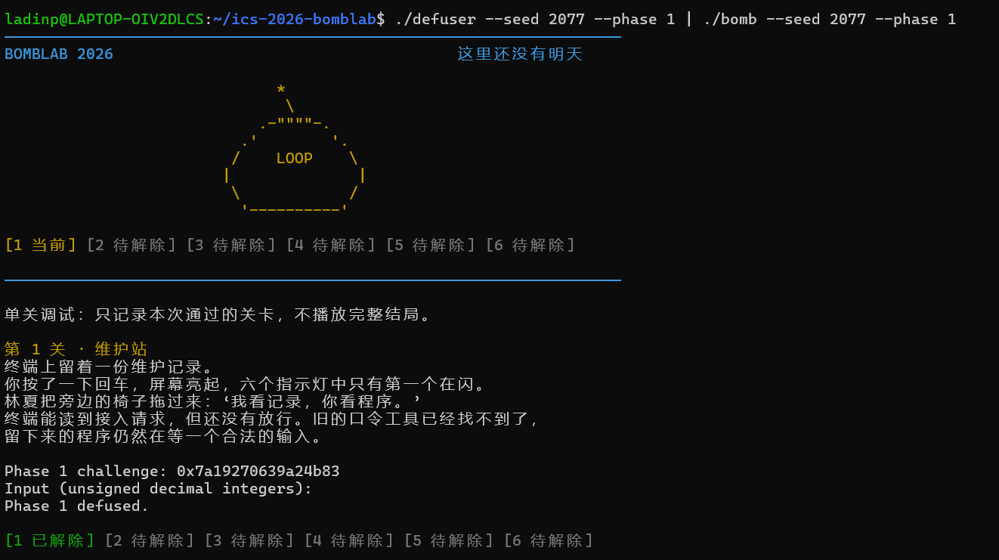
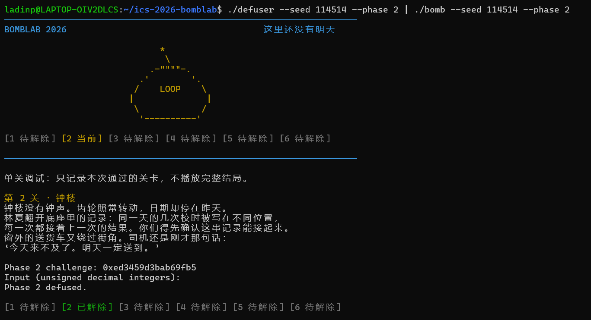
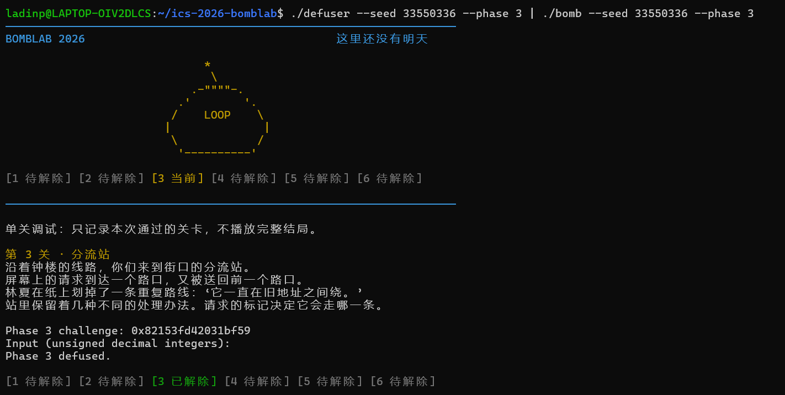
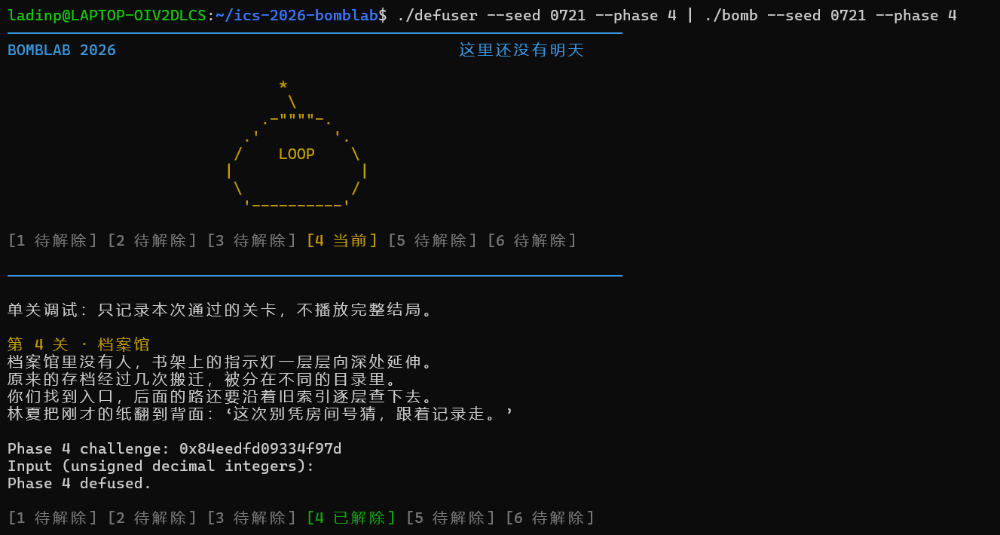
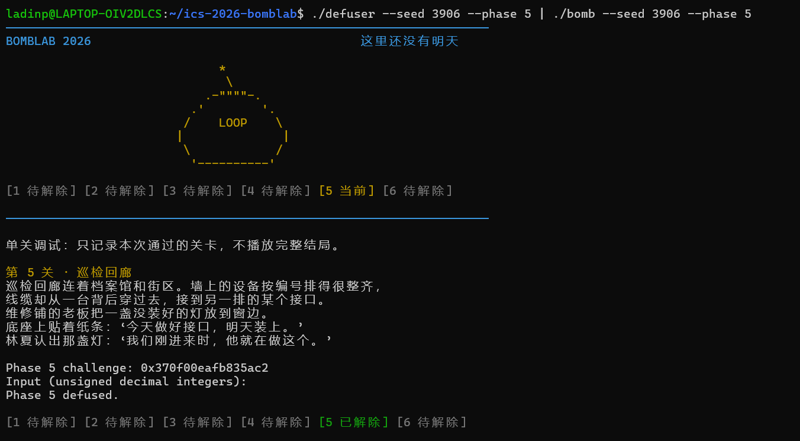
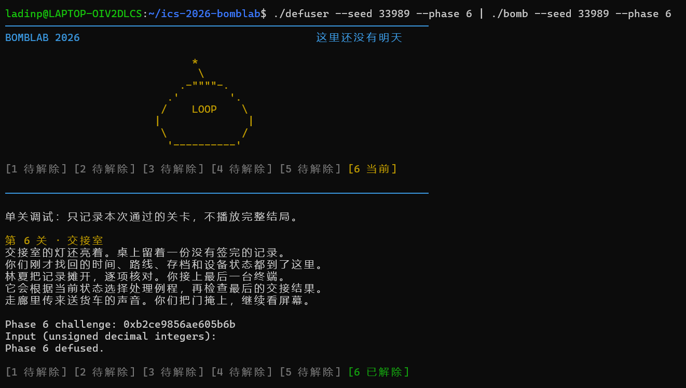
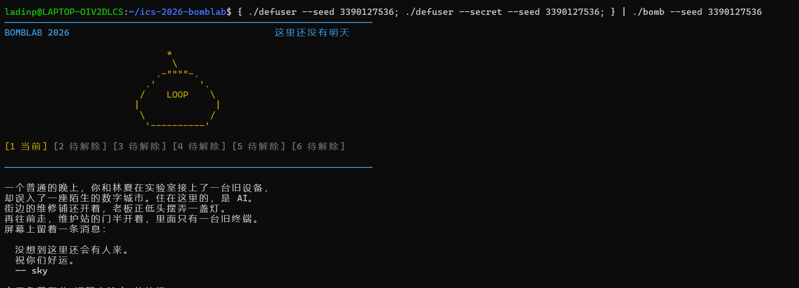
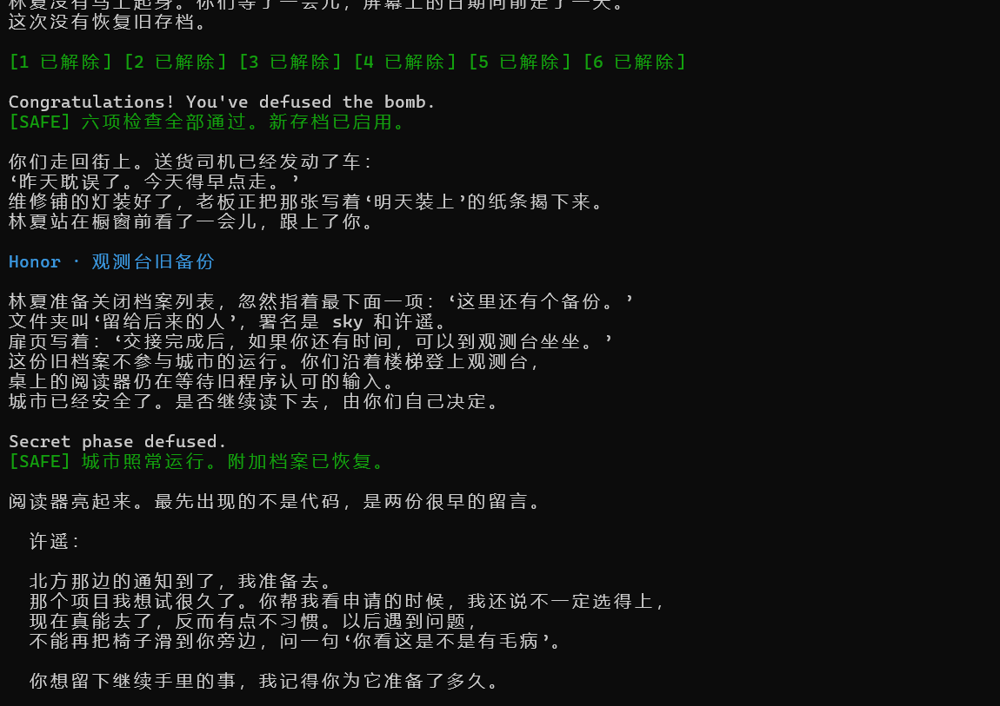
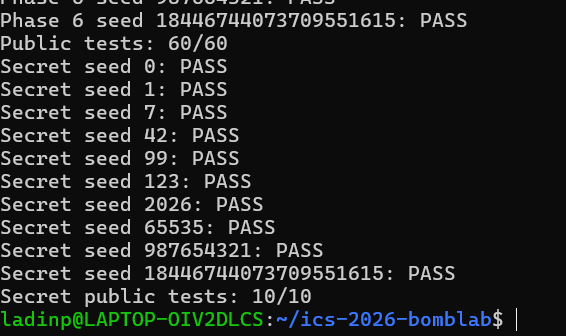

# ICS 2026 Bomb Lab 实验报告

## 0. 实验环境

- 操作系统：Ubuntu 26.04.1 LTS（x86_64）
- 编译器：gcc (Ubuntu 15.2.0-16ubuntu1) 15.2.0
- 调试/分析工具：`objdump`、`gdb`
- 仓库：`ics-2026-bomblab`

所有公式均按 `uint32_t` 运算，超过 `2^32` 的部分自动回绕；`challenge` 为64位无符号整数。

## 1. 各关卡分析

### Phase 1

#### 关键汇编

```
# phase_01：要求输入1个u32，比较输入与p1_compute(challenge)
40204d: call   valid_u32_fields          # 第 2 参数为 1
...
402063: cmp    $0x1,%eax                 # sscanf 必须解析出 1 个数
402068: mov    %r12,%rdi                 # rdi = challenge
40206b: call   p1_compute
402070: cmp    %eax,-0x14(%rbp)          # 输入 - 期望值
402073: sete   %al                       # 相等则通过

# p1_compute：拆分 challenge，依次调用三个 helper
401feb: mov    %edi,%r8d                 # lo=低32位
401fee: shr    $0x20,%rax                # hi=challenge>>32
401ff2: shr    $0x10,%rdx                # mid=challenge>>16（取低 32 位）
401ffe: call   p1_step0                  # s0
40200b: call   p1_step1                  # s1
402015: call   p1_step2                  # s2
40201b: xor    %ecx,%eax                 # 返回值=s2^s0
```

#### 恢复出的计算关系

```text
lo  = (uint32_t)challenge
hi  = (uint32_t)(challenge >> 32)
mid = (uint32_t)(challenge >> 16)

s0 = (lo + 2 * hi) ^ 0x3053
s1 = (5 * hi + mid) ^ 0xa2c3
s2 = (3 * s1) ^ (lo + 0x1dce)

v= s2 ^ s0
```

#### 推理过程

`phase_01` 先用 `valid_u32_fields(input, 1)` 限制输入必须是一个合法的 32 位无符号十进制整数，再用 `sscanf("%u")` 解析。而答案的计算通过`p1_compute`得到。把 64 位 `challenge` 拆成低 32 位 `lo`、高 32 位 `hi` 和从第 16 位开始的 `mid`，分别交给三个做乘加与异或的 helper。`p1_step0` 的 `lea (%rdi,%rsi,2)` 等价于 `lo + 2*hi`，`p1_step1` 的 `lea (%rdi,%rdi,4)` 等价于 `5*hi`，`p1_step2` 同理得到 `3*s1`。`p1_compute` 在返回前把暂存在 `%ecx` 的 `s0` 与 `%eax` 中的 `s2` 异或，因此输入应等于 `s2 ^ s0`。

#### 非公开 seed 验证

- seed：2077（不在 `tests/public.json` 的公开列表中）
- 结果：输出 `Phase 1 defused.`

#### 运行结果截图



### Phase 2

#### 关键汇编

```asm
# 检查 v0：challenge 的 bits 40..44
4020f0: shr    $0x28,%rax               # challenge >> 40
4020f4: and    $0x1f,%eax                # 取 5 位
4020f7: lea    (%rax,%rax,2),%eax        # * 3
4020fa: cmp    %eax,%esi                 # v0 与期望值比较

# 递推检查 v1..v5
4020fe: mov    $0x1c,%ecx               # shift = 28
402103: mov    $0x1,%edx                # i = 1
402108: mov    %r13,%rax                # rax = challenge
40210b: lea    (%rsi,%rsi,2),%esi        # esi = 3 * v[i-1]
40210e: shr    %cl,%rax                 # challenge >> shift
402111: and    $0xf,%eax                # 取 4 位
402114: add    %edx,%eax                # + i
402116: xor    %esi,%eax                # ^ (3 * v[i-1])
402118: mov    -0x40(%rbp,%rdx,4),%esi   # esi = v[i]
40211c: cmp    %eax,%esi
402120: add    $0x1,%rdx                # i++
402124: add    $0x5,%ecx                # shift += 5
402127: cmp    $0x6,%rdx
40212b: jne    402108                   # 循环到 i = 5
```

#### 恢复出的计算关系

```text
v[0]=3*((challenge>>40)&0x1f);
for (int i=1;i<6;i++){
  v[i]=(((challenge>>shift)&0xf)+i)^(3*v[i-1]);
  values[i]=v[i];
  shift+=5;
}
```

#### 推理过程

本关要求 6 个整数。第一个数只使用 `challenge` 的 bits 40..44：先右移 40 位，再与 `0x1f` 取出 5 位，最后乘 3。后续五个数由同一段循环生成：每次用 `shr %cl` 取出一个4位的，移位量从 28 开始每次加 5，取出的值加上当前下标 `i`，再与 `3 * v[i-1]` 异或。循环前 `%esi` 保存 `v0`，循环体先用 `3*v[i-1]` 覆盖它，比较完后再把当前 `v[i]` 读回 `%esi`，因此下一轮自然使用新的前一项。

#### 非公开 seed 验证

- seed：114514
- 结果：输出 `Phase 2 defused.`

#### 运行结果截图



### Phase 3

#### 关键汇编

```asm
# 第一个数等于 challenge & 7
402291: and    $0x7,%edi
402294: cmp    %edi,-0x18(%rbp)

# 计算第二个数的参数并调用跳转表
402299: mov    %r12,%rax
40229c: mov    %r12,%rsi
40229f: shr    $0x3,%rax                 # challenge >> 3
4022a3: shr    $0x20,%rsi                # challenge >> 32
4022a7: xor    %eax,%esi                 # x = 低32(>>3) ^ 高32
4022a9: call   p3_dispatch               # p3_dispatch(v0, x)
4022ae: cmp    %eax,-0x14(%rbp)          # 比较第二个数

# p3_dispatch：范围检查 + 跳转表
4021e8: cmp    $0x7,%eax
4021eb: ja     402235                    # index > 7 返回 0
4021ed: notrack jmp *0x4057e0(,%rax,8)   # 跳转表[index]
```

各 case 的内容：

```text
case0(x) = 5*x + 0x2964      
case1(x) = (4*x) ^ 0xbe63
case2(x) = (x ^ 0x56d4) + (x >> 2)
case3(x) = 5*x + 0xe682      
case4(x) = 3*x + 0x899f
case5(x) = (2*x) ^ 0x8874    
case6(x) = (x ^ 0x6780) + (x >> 1)
case7(x) = 5*x + 0x15531
```

跳转表映射关系为：

```text
index: 0  1  2  3  4  5  6  7
case : 5  1  7  2  6  4  3  0
```

#### 恢复出的计算关系

```text
v0 = challenge & 7
x  = (uint32_t)(challenge >> 3) ^ (uint32_t)(challenge >> 32)
v1 = case_table[v0](x)

values = v0,v1
```

其中 `case_table` 为 `[case5, case1, case7, case2, case6, case4, case3, case0]`。

#### 推理过程

`phase_03` 要求 2 个整数。第一个整数直接与 `challenge & 7` 比较，因此它同时充当 `p3_dispatch` 的下标。第二个输入先用 `mov %r12,%rax` / `shr $0x3,%rax` 得到 `challenge >> 3`，再用 `shr $0x20,%rsi` 得到高 32 位，然后 `xor %eax,%esi` 合成参数 `x`。`p3_dispatch` 先检查 `index <= 7`，再通过 `0x4057e0` 处的函数指针跳转表分派。读取跳转表可知下标与 case 编号并不一致，把每个 case 的 `lea`/`xor`/`shr`/`add` 翻译成表达式后即可得到 `v1`。

#### 非公开 seed 验证

- seed：33550336
- 结果：输出 `Phase 3 defused.`

#### 运行结果截图



### Phase 4

#### 关键汇编

```asm
# phase_04 准备 p4_walk 的四个参数
402378: mov    %r12,%rcx
40237b: mov    %r12,%rax
40237e: mov    %r12d,%edi
402381: xor    %esi,%esi                 # low = 0
402383: shr    $0x20,%rax                # challenge >> 32
402387: shr    $0x7,%rcx                 # challenge >> 7
40238b: and    $0x7f,%edi                # target = challenge & 0x7f
40238e: mov    $0x7f,%edx                # high = 0x7f
402393: xor    %eax,%ecx                 # salt = (>>7 低32) ^ 高32
402395: call   p4_walk
40239a: cmp    %eax,-0x14(%rbp)          # 比较输入

# p4_walk：二分取 mid
4022c4: mov    %edi,%eax                 # target
4022c6: mov    %edx,%edi                 # high
4022c8: sub    %esi,%edi                 # high - low
4022ca: shr    $1,%edi                   # 无符号除以 2
4022cc: add    %esi,%edi                 # mid = low + (high-low)/2
4022ce: cmp    %eax,%edi
4022d0: je     402320                    # mid == target 基准情形
4022d7: lea    (%rdi,%rcx,1),%ebx        # ebx = mid + salt
```

递归回溯部分：

```asm
# target > mid：区间 [mid+1, high]
4022ec: lea    (%rax,%rax,4),%eax        # 5 * 子结果
4022ef: xor    %ebx,%eax                 # ^ (mid + salt)
4022f6: xor    $0x9,%eax                 # ^ 0x9

# target < mid：区间 [low, mid-1]
40230a: lea    (%rax,%rax,4),%eax        # 5 * 子结果
40230d: xor    %ebx,%eax                 # ^ (mid + salt)
402314: xor    $0x12,%eax                # ^ 0x12

# 基准情形
402320: lea    0xa7(%rdi),%eax           # mid + 0xa7
402326: xor    %ecx,%eax                 # ^ salt
```

#### 恢复出的计算关系

```text
target = challenge & 0x7f
salt   = (uint32_t)(challenge >> 7) ^ (uint32_t)(challenge >> 32)

int p4_walk(int target,int low,int high,int salt){
    int mid=low+(high-low)/2;
    if(mid==target){
        return (mid+0xa7)^salt;
    }
    if(mid>target){
        uint32_t child=p4_walk(target,low,mid-1,salt);
        return ((5u*child)^(mid+salt))^0x12u;
    }
    uint32_t child=p4_walk(target,mid+1,high,salt);
    return ((5*child)^(mid+salt))^0x9u;
}
values[0]=p4_walk(target,low,high,salt);
```

#### 推理过程

本关只要求 1 个整数。`phase_04` 从 `challenge` 中取出 `target`（低 7 位）和 `salt`（`challenge >> 7` 的低 32 位与高 32 位异或），再把初始区间设为 `[0, 0x7f]`。`p4_walk` 用 `high - low` 的无符号右移计算中点，因此等价于在 128 个位置做二分查找。找到 `target` 后进入基准情形返回 `(mid + 0xa7) ^ salt`；之后沿调用栈回溯，每层先把子结果乘 5，再异或本层的 `mid + salt`，最后根据 “target 偏大/偏小” 分别异或 `0x9` 或 `0x12`。

#### 非公开 seed 验证

- seed：0721
- 结果：输出 `Phase 4 defused.`

#### 运行结果截图



### Phase 5

#### 关键汇编

```asm
# p5_traverse：选择链表头，计算初始校验和
4023bd: and    $0x7,%eax                 # idx = challenge & 7
4023c0: shr    $0x3,%rcx                 # challenge >> 3
4023c4: mov    0x405b20(,%rax,8),%rdx    # node = p5_heads[idx]
4023cf: shr    $0x20,%rdi                # challenge >> 32
4023d3: shr    $0x6,%rax                 # challenge >> 6
4023d7: mov    0x8(%rdx),%esi            # esi = node->tag
4023da: xor    %edi,%eax                 # ^ 高 32 位
4023dc: xor    0xc(%rdx),%eax            # ^ node->value
4023df: mov    %ecx,%edi
4023e1: xor    $0x9d8e,%eax              # ^ 0x9d8e
4023e6: mov    %esi,(%r8)                # *out_tag = node->tag
4023e9: add    %esi,%eax                 # += node->tag
4023eb: and    $0x3,%edi                 # steps = (challenge>>3) & 3
4023ee: je     40240a                    # steps == 0 直接返回

# 沿 next 再走 steps 步
4023f5: mov    (%rdx),%rdx               # node = node->next
4023fb: mov    0x8(%rdx),%esi            # tag
4023fe: xor    0xc(%rdx),%eax            # acc ^= node->value
402401: add    %esi,%eax                 # acc += node->tag
402403: mov    %esi,(%r8)                # *out_tag = tag
402406: cmp    %ecx,%edi
402408: jae    4023f5                    # 继续遍历
```

节点结构为 16 字节：

```text
+0x0  next 指针（8 字节）
+0x8  tag   （4 字节）
+0xc  value （4 字节）
```

链表数据：

```text
N6 -> N5 -> N8 -> N4 -> N3 -> N7 -> N10 -> N0 -> N1 -> N11 -> N9 -> N2 -> NULL

N0 : tag=797  value=7993      N1 : tag=2844 value=45547
N2 : tag=2421 value=65424     N3 : tag=327  value=58204
N4 : tag=1907 value=24539     N5 : tag=2678 value=1325
N6 : tag=2130 value=8209      N7 : tag=1142 value=25759
N8 : tag=1574 value=28673     N9 : tag=126  value=61776
N10: tag=595  value=9322      N11: tag=1365 value=55355
```

`p5_heads` 映射为：

```text
idx:  0   1   2   3   4   5   6   7
head: N6  N5  N8  N4  N3  N7  N10 N0
```

#### 恢复出的计算关系

```text
idx   = challenge & 7
steps = (uint32_t)(challenge >> 3) & 3
node  = p5_heads[idx]

static uint32_t p5_traverse(uint64_t challenge,uint32_t *out_tag){
    uint32_t idx=(uint32_t)challenge&7u;
    uint32_t steps=((uint32_t)(challenge>>3))&3u;
    const P5Node *node=p5_heads[idx];
    uint32_t acc=(uint32_t)(challenge>>6)
                ^(uint32_t)(challenge>>32)
                ^node->value
                ^0x9d8eu;
    acc+=node->tag;
    *out_tag=node->tag;
    for(uint32_t i=0;i<steps;++i){
        node=node->next;
        acc=(acc^node->value)+node->tag;
        *out_tag=node->tag;
    }
    return acc;
}
values[0]=acc;
values[1]=tag;
```

#### 推理过程

`phase_05` 要求 2 个整数：第一个是校验和，第二个是遍历结束时最后一个节点的 `tag`。`challenge` 的低 3 位从 `p5_heads` 中选一个链表头；bits 3..4 决定沿 `next` 再走多少步（0 到 3 步）。初始校验和由 `challenge >> 6`、`challenge >> 32`、头节点的 `value` 和常数 `0x9d8e` 异或混合，再加上头节点的 `tag`。循环中每次先取 `node->next`，把当前校验和与该节点 `value` 异或，再加该节点 `tag`，并同步更新 `last_tag`。通过读取 `.rodata` 中 `p5_heads` 和各节点的 `next/tag/value`，可以还原出上面这条主链；不同下标只是从主链的不同位置开始。

#### 非公开 seed 验证

- seed：3906
- 结果：输出 `Phase 5 defused.`

#### 运行结果截图



### Phase 6

#### 关键汇编

```asm
# p6_dispatch
40251c: shr    $0x6,%rdi                 # challenge >> 6
402520: mov    %rbx,%rax
402523: shr    $0x20,%rax                # challenge >> 32
402527: xor    %eax,%edi                 # mixed = (>>6) ^ 高32
402530: and    $0x38,%ebx                # 第二次调用的字节偏移
402533: and    $0x7,%eax                 # idx1 = challenge & 7
402536: call   *0x405dc0(,%rax,8)        # x1 = p6_ops[idx1](mixed)
40253d: xor    $0x9866,%eax              # x1 ^= 0x9866
402542: mov    %eax,%edi
402544: call   *0x405dc0(%rbx)           # x2 = p6_ops[idx2](x1)
40254f: add    $0xa01c,%eax              # answer = x2 + 0xa01c
```

函数指针表 `p6_ops` 的映射关系：

```text
下标: 0   1   2   3   4   5   6   7
函数: op3 op4 op5 op5 op0 op2 op1 op2
```

六个运算函数：

```text
op0(x) = ((x >> 2) ^ x) + 0x39b3
op1(x) = (x + 0x9e5) ^ (x >> 2)
op2(x) = (x ^ 0x440a) + (x << 5)
op3(x) = ror32(x, 1)
op4(x) = rol32(x, 3) ^ 0xaff8
op5(x) = (0xb950 + 8*x) ^ (5*x)
```

#### 恢复出的计算关系

```text
static int p6_dispatch(uint64_t challenge){
    uint32_t mixed=(uint32_t)(challenge>>6)^(uint32_t)(challenge>>32);
    uint32_t idx1=(uint32_t)(challenge&7u);
    uint32_t idx2=((uint32_t)(challenge>>3))&7u;
    uint32_t x1=p6_ops[idx1](mixed);
    x1^=0x9866u;
    uint32_t x2=p6_ops[idx2](x1);
    return x2+0xa01cu;
}
values[0]=p6_dispatch(challenge);
```

其中 `p6_ops = [op3, op4, op5, op5, op0, op2, op1, op2]`。

#### 推理过程

本关只要求 1 个整数。`p6_dispatch` 先用 `challenge >> 6` 的低 32 位与 `challenge >> 32` 异或得到参数 `mixed`，然后用 `challenge & 7` 作为第一次函数指针调用的下标。第一次调用结果异或 `0x9866` 后作为第二次调用的参数；第二次调用通过 `challenge & 0x38` 作为表内字节偏移，因为每个函数指针占 8 字节，所以等价于下标 `(challenge >> 3) & 7`。最后加 `0xa01c` 得到期望值。

#### 非公开 seed 验证

- seed：33989
- 结果：输出 `Phase 6 defused.`

#### 运行结果截图



## 2. Honor（secret）

### 关键汇编

```asm
# secret_gate：检查整行布局，再调用 secret_phase
4026fc: call   strlen@plt
402701: sub    $0x24,%rax               # len - 36
402705: cmp    $0x7f,%rax               # 要求 36 <= len <= 163
402709: jbe    402720
...
402726: call   secret_copy              # buffer = line
40272b: cmpl   $0x4e45504f,-0xb0(%rbp)  # buffer[32..35] == "OPEN"
402735: jne    40270b
40273d: lea    -0xac(%rbp),%rdi         # 第 1 参数 = line + 36
402744: call   secret_phase

# secret_phase：解析 3 个 u32，并按 challenge/context 校验
402645: and    $0x3,%ecx                # rl = context & 3
402648: cmp    %ecx,-0x2c(%rbp)         # v0 == rl
...
402650: imul   $0xbda1,%ecx,%r9d        # r9 = 0xbda1 * rl
402665: xor    %r13d,%r8d               # B = 低32(context) ^ 高32(context)
402662: xor    %r12d,%esi               # A = 低32(challenge) ^ 高32(challenge)
40266e: xor    %r13d,%r9d               # r9 ^= (context >> 16)
402671: xor    %r8d,%edi                # A ^ B
402674: call   secret_mix
402679: xor    %r9d,%eax                # m ^ r9
40267c: cmp    %eax,-0x28(%rbp)         # v1 == m ^ r9
...
402681: shr    $0x3,%esi                # A >> 3
402684: lea    0xd4e8(%r8,%rcx,1),%edx  # 0xd4e8 + B + rl
40268c: add    %esi,%edx
40268e: xor    %edx,%eax                # (m ^ r9) ^ (...)
402690: cmp    -0x24(%rbp),%eax         # v2 比较
```

`secret_mix`：

```asm
4025c6: rol    $0x3,%eax                # rol32(x, 3)
4025c9: add    $0xbda1,%eax
4025ce: xor    $0xd4e8,%eax
```

### 恢复出的计算关系


```text
uint32_t r1=(uint32_t)context&3;
uint32_t a=(uint32_t)challenge^(uint32_t)(challenge>>32);
uint32_t b=(uint32_t)context^(uint32_t)(context>>32);
uint32_t c=(uint32_t)(context>>16);
uint32_t r9=(0xbda1*r1)^c;
uint32_t m=((rol32(a^b,3)+0xbda1)^0xd4e8);
uint32_t v0,v1,v2;
v0=r1;
v1=m^r9;
v2=(m^r9)^(0xd4e8+b+r1+(a>>3));
```

整行第七行的布局：

```text
[0  .. 31]   32 个任意可打印字符（内容不被检查）
[32 .. 35]   必须是 "OPEN"（小端 0x4e45504f）
[36 ..   ]   恰好 3 个无符号十进制 32 位整数：v0 v1 v2
```

长度必须满足 `36 <= strlen(line) <= 163`，从第 36 字节起 `valid_u32_fields(..., 3)` 必须通过。最省事的前缀是 32 个空格，再接 `OPEN` 和三个数。
```
int n=snprintf(out,cap,"%32sOPEN %u %u %u","",v0,v1,v2);
if(n<0||(size_t)n>=cap)return 1;
return 0;
```

### 推理过程

`main` 先用 `transcript_context` 从前六行答案计算 `context`，再用 `phase_challenge(seed, 7)` 得到第七关的 `challenge`，最后调用 `secret_gate(line, challenge, context)`。`secret_gate` 先把整行复制到局部缓冲区，检查长度范围，并确认缓冲区第 32 到 35 字节是 `OPEN`；随后把 `line + 36` 交给 `secret_phase`。`secret_phase` 要求从第 36 字节起正好 3 个 u32：第一个与 `context & 3` 比较；第二个与 `secret_mix(A ^ B) ^ r9` 比较；第三个再与 `(m ^ r9) ^ (0xd4e8 + B + rl + (A >> 3))` 比较。按 `secret_mix` 的 `rol + add + xor` 与 `secret_phase` 的寄存器数据流整理，即可得到上面的 `v0`、`v1`、`v2`。`solve_secret` 用 `snprintf(out, cap, "%32sOPEN %u %u %u", "", v0, v1, v2)` 生成这一行。

### 非公开 seed 验证

- seed：43、2027
- 命令：

  ```sh
  { ./defuser --seed 43;   ./defuser --secret --seed 43;   } | ./bomb --seed 43
  { ./defuser --seed 2027; ./defuser --secret --seed 2027; } | ./bomb --seed 2027
  ```

- 结果：两个 seed 均输出 `Secret phase defused.`

### 运行结果截图




### 总结果


## 3. 工具使用说明

- 使用 `objdump -d --no-show-raw-insn` 导出 `phase_01` 到 `phase_06`、各 helper、`secret_*` 以及跳转表/函数指针表相关数据，逐条翻译成 C 表达式。
- 使用 `gdb` 的断点、`x/` 查看内存、`disassemble` 等只读操作辅助核对数据布局；没有用 `set` 修改炸弹内部变量、寄存器或内存。
- 使用 `make` 编译，使用 `./defuser ... | ./bomb ...` 和公开/非公开 seed 验证公式；上文的非公开 seed 记录均为实际运行结果。
- 使用 AI 助手协助整理汇编注释和报告排版
